<div align="center">

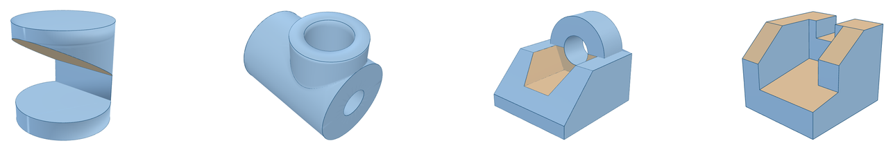

<h1>engineering-drawing-3d</h1>

<p><b>工程制图备考 · 把三视图反推成能转的立体图。</b><br>
给 AI 一张截图，换回一个可以任意旋转、<i>并且经过数值自检</i>的三维模型。</p>

<p>


</p>

<p><sub>一个 Agent Skill · 9 道工程制图真题实测 · 体积误差多在 0.000%</sub></p>

</div>

---

> **TL;DR** — An agent skill that turns a three-view engineering drawing (front / top / side) into a rotatable 3D model. It doesn't just eyeball the shape: every model must pass a volume check against a hand-derived analytic value, a closed-mesh check, and a **re-projection check** that maps the model's edges back onto the original scan. Ships a declarative geometry kit (`hull` / `subtract` / `extrude` / `sector` / `fan`) and a single-file viewer that works offline.

## 这是什么

一套「看图 → 建模 → 自检 → 出页面」的工作流，封装成 Agent Skill。宿主（WorkBuddy、Claude Code 等）读到 `SKILL.md` 就学会了怎么用它的脚本和几何工具包。

它解决的不是"画个大概"，而是**三视图还原里最容易出错的那部分**：

- 图上那条虚线到底是被谁挡住的哪条边？
- 两个视图对得上、第三个视图却少了条线，是漏画还是形体解错了？
- 选择题给的四个立体图长得几乎一样，靠什么定量判决？

所以它不靠肉眼比对，而是把模型**重新投影回原图的像素坐标**，一条线一条线地压上去。

## 效果

9 道真题，左边是扫描件，右边是还原出的立体图（都可以在交付的 HTML 里拖着转）：

<table>
<tr>
<td width="33%" align="center"><a href="docs/images/case-01.png">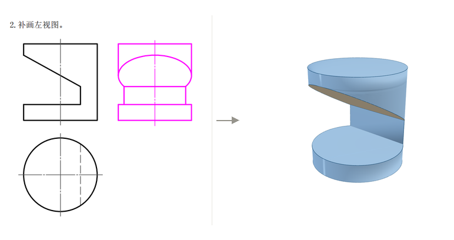</a><br>
<b>① 竖直圆柱 + 斜切 + 台阶</b><br>
<sub>斜切面与柱面的交线是椭圆弧，半轴比 0.55 反过来印证斜面斜率 0.57</sub></td>
<td width="33%" align="center"><a href="docs/images/case-02.png">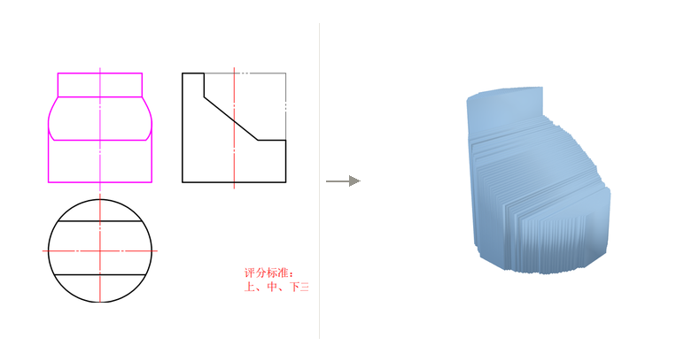</a><br>
<b>② 快速模式：视觉外壳</b><br>
<sub>一条命令 3.5 秒。曲面被台阶化了 —— 这是模式 A 的边界，不是 bug</sub></td>
<td width="33%" align="center"><a href="docs/images/case-03.png">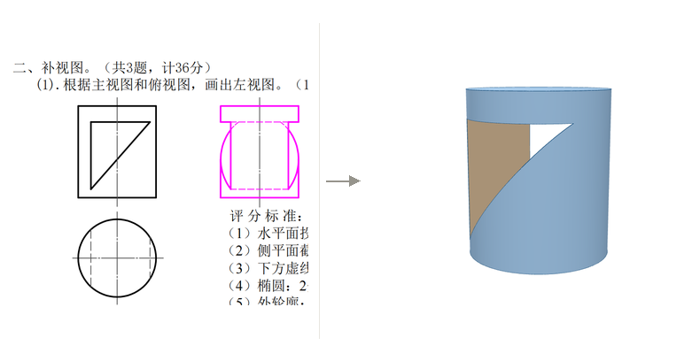</a><br>
<b>③ 圆柱 + 贯通三角孔</b><br>
<sub>998/1178 个三角形绕向相反，双面材质下完全看不出来</sub></td>
</tr>
<tr>
<td align="center"><a href="docs/images/case-04.png">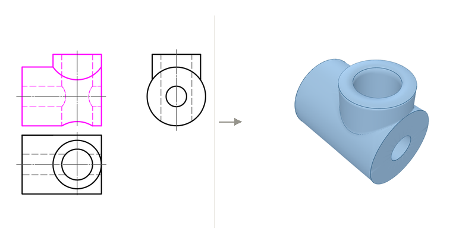</a><br>
<b>④ 圆筒 + 竖直凸台 + 竖孔</b><br>
<sub>三处相贯线：凸台∩筒面、竖孔∩筒面、竖孔∩内孔。列成 7 张曲面清单</sub></td>
<td align="center"><a href="docs/images/case-05.png">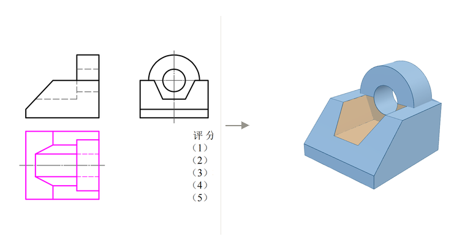</a><br>
<b>⑤ 支架 · 斜面台阶 + 半圆凸台 + 倒梯形槽</b><br>
<sub>顶面当 12 边形硬啃，耳切穿模导致体积偏 5.2%；拆成两条条带后 0.003%</sub></td>
<td align="center"><a href="docs/images/case-06.png">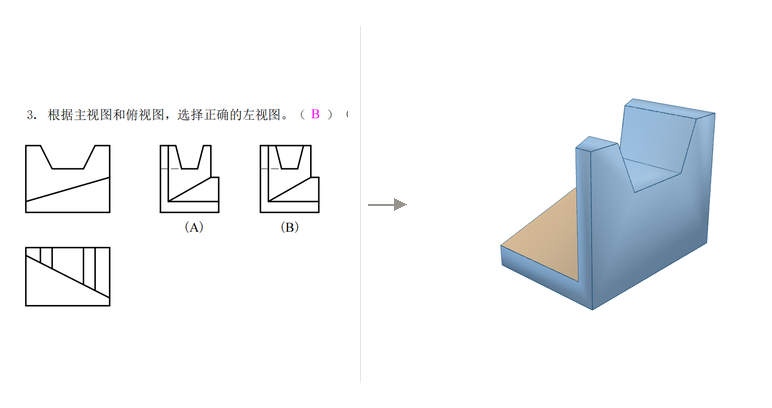</a><br>
<b>⑥ 选择题：槽口算不算外轮廓</b><br>
<sub>落线率 93.2% / 99.4% 肉眼分不出；<b>最长悬空 49 px vs 3 px</b> 才是判决性的</sub></td>
</tr>
<tr>
<td align="center"><a href="docs/images/case-07.png">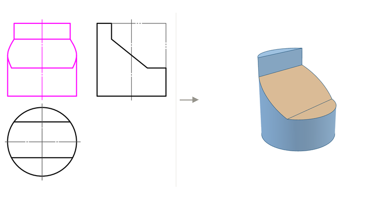</a><br>
<b>⑦ 圆柱 + 圆冠凸台 + 斜切平台</b><br>
<sub>工具包没有"圆柱"，用 128 个侧平面当半空间拼出来，体积误差 0.043%</sub></td>
<td align="center"><a href="docs/images/case-08.png">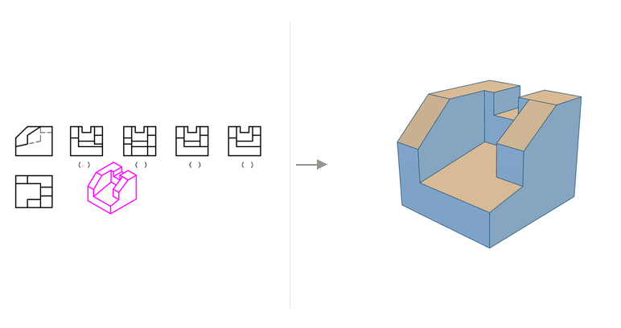</a><br>
<b>⑧ 选择题：四个左视图挑一个</b><br>
<sub>顶面开槽让交界面半埋半露，拼块法体积偏 1.6%；改成 25 个显式面片后 0.000%</sub></td>
<td align="center"><a href="docs/images/case-09.png">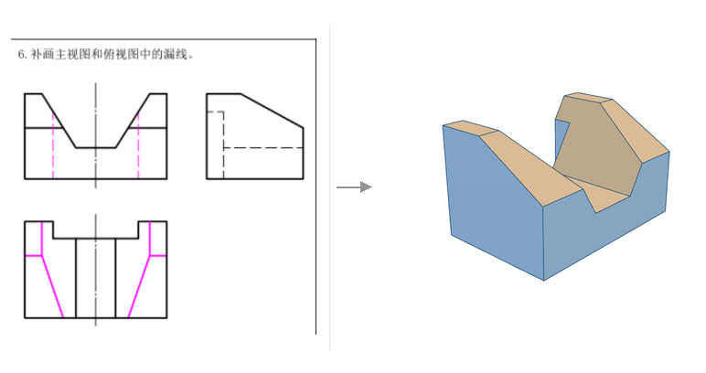</a><br>
<b>⑨ 补画漏线</b><br>
<sub>反投影算出漏的全是隐蔽线，8 条，与手写答案逐条吻合 —— 见下方复盘</sub></td>
</tr>
</table>

> **在线试玩** → [第 ⑤ 题（支架）的可旋转页面](https://nickfly060606-maker.github.io/engineering-drawing-3d/demo.html)
> 拖拽旋转 · 滚轮缩放 · 右键平移 · 底部切主视/俯视/左视/右视。单文件、three.js 已内联，断网也能开。

## 为什么不是「看着像就行」

一张还原得漂亮但错了 3% 的模型，比没有更糟 —— 你会拿它去交作业。所以每条链路都有闸门：

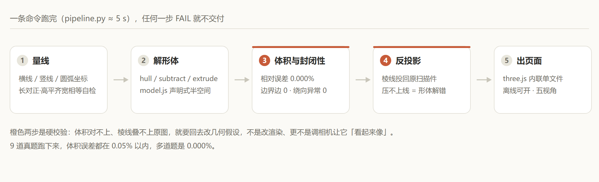

| 可能翻车的地方 | 肉眼能不能发现 | 拦截手段 |
|---|---|---|
| 斜面方向解反了 | 3D 里看着也挺顺眼 | **反投影**：棱线投回原扫描件，红线必须压在描边上 |
| 少切/多切一块 | 很难 | **解析体积 vs 有符号体积**，>1% 直接 FAIL |
| 面没闭合，有缝 | 光照下看不出来 | **边界边计数**（T 形接点补齐后必须为 0） |
| 绕向反了 | 双面材质下看不出来，明暗整体是反的 | 有符号体积为负 → 全局翻转 |
| 页面白屏 | 只能看到白屏 | `node --check` + DOM 探针（canvas 尺寸 / 运行时错误 / 非背景像素占比） |

实测数字（9 题中最差与最好）：

- 体积相对误差：**0.000%**（第 8、9 题）～ **0.043%**（圆柱用 128 边形逼近的残差）
- 边界边：**0**（真封闭，不是"通常可忽略"）
- 反投影落位命中率：**100%**（第 6 题）· 86.5%（第 7 题，俯视图是圆、手性只能靠约定消歧）

## 快速开始

```bash
# 1) 放进宿主的 skills 目录（仓库根目录就是 skill 本体）
#    skill 名是 three-view-to-3d，所以克隆到同名目录
git clone https://github.com/nickfly060606-maker/engineering-drawing-3d.git \
  ~/.workbuddy/skills/three-view-to-3d
#   Claude Code 用：  ~/.claude/skills/three-view-to-3d
#   只要当前项目用：  <项目>/.workbuddy/skills/three-view-to-3d

# 2) 依赖
pip install pillow numpy          # node ≥ 18 只用于网格自检与语法检查
```

然后对 AI 说「还原这个」，附上三视图截图。也可以直接调脚本：

```bash
# 模式 A：4 秒出一版，纯外部形体够用
python <skill>/scripts/auto_reconstruct.py \
  --image 题目.png --out _ai_work/auto --html 三视图还原-立体图.html

# 模式 B：精确还原（内部孔槽、圆柱、相贯线必须走这条）
python <skill>/scripts/measure.py --image 题目.png --outdir _ai_work/measure
#   → 按量出来的坐标写 _ai_work/model.js（几何由 assets/model_kit.js 声明，不手写面片）
python <skill>/scripts/pipeline.py --model _ai_work/model.js \
  --image 题目.png --html 三视图还原-立体图.html --expect 856723.2
```

`pipeline.py` 一次跑完五步并逐项打 PASS/FAIL：出页面（含模块语法检查）→ 体积/封闭性 → 反投影 → 机位预览 → 无头实拍。端到端约 5 秒。

## 两种模式

| | 模式 A · 视觉外壳 | 模式 B · 参数化精确 |
|---|---|---|
| 适用 | 纯平面组合体、外部切割体 | 有内部孔/槽/空腔、圆柱、球、相贯线 |
| 命令 | 一条 `auto_reconstruct.py` | 3 条（量线 → 写模型 → pipeline） |
| 耗时 | 4 s | ≈30 s（模型 20–60 行） |
| 棱线 | 不画 | 按二面角自动提取，可逐条讲解 |
| 虚线 | 会被填平（取"满足三视图的最大形体"） | 能精确表达 |

模式 A 的原理是 `V(x,y,z) = F(x,y) ∧ T(x,z) ∧ L(z,y)` —— 三个视图的实心掩码直接做交，不用反推形体；代价是内部空腔被填平、斜曲面变成梯田（就是上面第 ② 张图）。默认先试模式 A，遇到孔、槽、相贯线再转模式 B。

## 几何工具包

模型片段是声明式的，`assets/model_kit.js` 会被 `build_viewer.py` 自动注入，不手写顶点：

```js
const MODEL = (function () {
  const { hull, subtract, extrude, sector, plate, fan, finish } = __KIT;

  const BASE = box(0, 156, 0, 92, 0, 104);
  const SLOT = [zLE18, xGE31.33, xLE124.67];        // 后端方槽
  const BODY = subtract(BASE, SLOT, { hl: [zLE18] });

  return finish([BODY]);   // 合并 + 定绕向 + 剔内面 + 提棱线
})();
```

| 调用 | 表达什么 | 典型用途 |
|---|---|---|
| `hull(planes, {hl, skip})` | 半空间交集 `n·p ≤ d` | 长方体、楔形、被斜切/掏过的块 |
| `subtract(base, cuts)` | 凸体削掉若干半空间 | 通槽、切口、台阶（自动拆成 `2^k−1` 块） |
| `extrude(profile, axis, a, b)` | 等截面拉伸 | 梯形槽、L 形、任意多边形柱 |
| `sector` / `plate` / `fan` | 圆柱、圆孔、扇形面 | 凸台、通孔、孔口、端面减半圆 |
| `finish(list)` | 合并 + 定向 + 剔内面 + 提棱线 | 返回值直接就是 `MODEL` |

`finish` 里最关键的是**内面剔除**：把每个三角形重心沿外法线挪一点点，落进别的块内部就删掉。它决定了"拼块"这条路能不能走通 —— 而它有一个前提，见下面第 ⑧ 题。

## 三个案例复盘

### ⑧ 为什么「拼块」这条路会失败

第 8 题的形体是顶面开了一条槽的方块。按惯例拆成 8 块凸体去拼：每块的体积都算对了，加起来正好等于解析值 152024.2。但 `finish` 之后：

```
体积 154517.36  (+1.640%)   边界边 24   剔内面 35
```

原因是槽的两侧壁**一半埋在邻块里、一半露在外头**（邻块只到槽底高）。而内面剔除是按**整个三角形**判的 —— 要么整块删，要么整块留，没有中间选项。于是槽的侧壁被删掉一半，体积偏大。

最小复现是两个相邻棱柱拼在一起：`culled 4`，体积 43258 而正确值是 39990（+8.2%）。

修法是放弃拼块，改用**显式面片**：25 个多边形把 6 块顶面 + 底面 + 9 个外壁 + 9 个内部立面全铺出来。绕向不手算，用 Newell 公式算法线再和期望外法线点积，为负就反序：

```js
function F(poly, nOut, hl) {
  let n = [0, 0, 0];
  for (let i = 0; i < poly.length; i++) {
    const a = poly[i], b = poly[(i + 1) % poly.length];
    n[0] += (a[1] - b[1]) * (a[2] + b[2]);
    n[1] += (a[2] - b[2]) * (a[0] + b[0]);
    n[2] += (a[0] - b[0]) * (a[1] + b[1]);
  }
  if (n[0]*nOut[0] + n[1]*nOut[1] + n[2]*nOut[2] < 0) poly = poly.slice().reverse();
  S.face(poly, hl);
}
```

一次通过：体积 152024.206 / 解析 152024.2 = **0.000%**，边界边 0。

> **可复用的判据**：相邻两块高度不同时，交界面必然"半埋半露"，别拼块，直接铺面清单。

### ⑨ 补画漏线：让模型告诉你漏了哪几条

题目只给主视图和俯视图（左视图完整），要补出漏画的线。人眼看不出，是因为漏的全是隐蔽线。

做法是把模型跑通后，把它的棱线按 `front / top / left` 三套坐标**投回原扫描件**，再用射线判可见性（虚线画成虚线），叠在扫描件上：

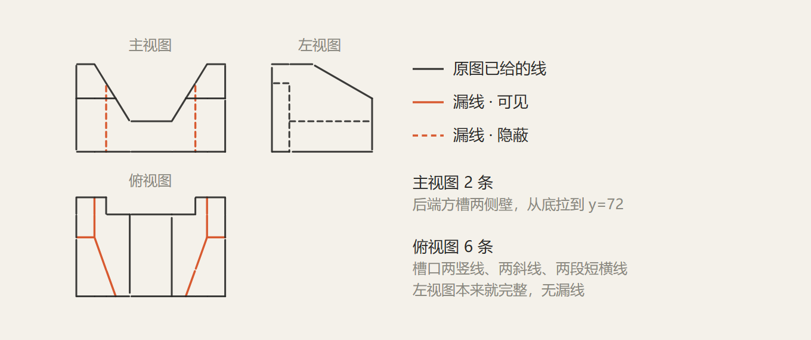

结果：主视图 2 条（后端方槽两侧壁，从底拉到 y=72），俯视图 6 条（槽口两竖线、两条斜线、两段短横线），左视图本来就完整。**一条不多，一条不少**。

那两条斜线是最容易漏的：顶面一旦前倾，V 形槽的槽口边就不再是直线，而是斜壁与前倾面的交线，`x = 19 + (0.5806/1.6216)(z−42)`，z=42 时在 x=19，z=104 时到 41.2。

### ⑥⑧ 选择题：靠什么定量判决

四个选项长得几乎一样时，命中率不够用。把 `--boxes` 把"左视图"分别指向每个选项各跑一次反投影，统计**每条投影线有多少长度在原图上找不到对应的线**：

| 选项 | 落线率 | 最长悬空段 | 判决 |
|---|---|---|---|
| A | 93.2% | **49 px**（正在槽口上方的顶边） | ✗ 把槽口画成了外轮廓缺口 |
| B | 99.4% | 3 px（抗锯齿噪声） | ✓ |

93 与 99 的区别肉眼看不出来，49 px 的悬空是决定性的。第 8 题同理 —— 四个选项的差别只在三处：某条横线在左还是在右、两条竖线画到哪为止：

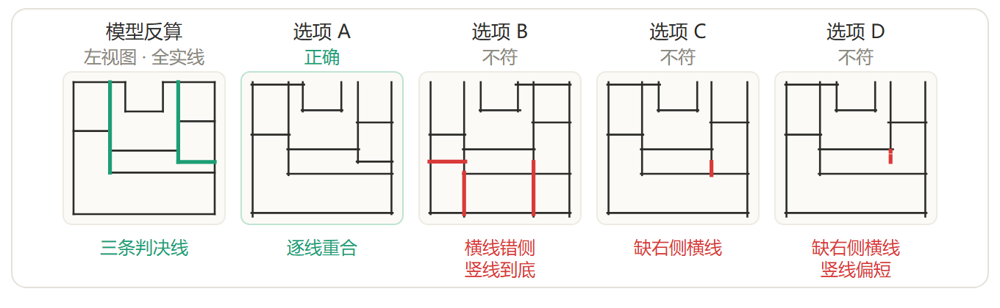

## 目录结构

```
engineering-drawing-3d/
├── SKILL.md                     # 宿主读这个：模式选择、步骤、48 条硬规则（全是踩过的坑）
├── docs/
│   ├── cases.md                 # 9 道题的完整复盘：形体、参数、坑、验证数字
│   └── images/
├── scripts/
│   ├── auto_reconstruct.py      # 模式 A 一键入口
│   ├── measure.py               # 量线：横线/竖线/圆弧/斜线坐标 + 三项投影关系自检
│   ├── pipeline.py              # 模式 B 一条命令跑完五步校验与出页面
│   ├── build_viewer.py          # 注入几何 → 单文件 HTML（含模块语法检查）
│   ├── check_mesh.js            # 体积 / 边界边 / 绕向 / 退化面
│   ├── project_mesh.py          # 反投影叠回原图像素坐标（自动标定 + 判手性）
│   ├── shot.py                  # 无头实拍 + DOM 探针
│   ├── raycast_preview.py       # 离线机位预览
│   └── inspect_views.py         # 视图放大与实心掩码
├── assets/
│   ├── model_kit.js             # 几何工具包：hull / subtract / extrude / sector / plate / fan / finish
│   ├── model_example.js         # 模式 B 起手模板
│   ├── viewer_template.html     # 渲染外壳
│   └── vendor/                  # three.js r161 + OrbitControls + BufferGeometryUtils（用于内联）
└── references/
    ├── read-views.md            # 判读规则、线型含义、完整例题推理
    └── modeling-recipes.md      # MODEL 契约、几何配方、相机/光照经验值
```

`SKILL.md` 里的 48 条硬规则是这个项目真正的沉淀 —— 每条都对应一次真实翻车，比如：

- 不要用 `EdgesGeometry` 自动提边（顶点未合并时每条三角形边都会成轮廓，画成一片网）
- 半空间是 `n·p ≤ d` 不是 `≥`，写反一条整块消失，而页面照样渲染
- 引擎内联，不要引 CDN（2026-11-10 实测：jsdelivr 12 秒只下了 9.6 KB，页面白屏）
- 圆弧的极值行会被误判成横线（R=98 px 时顶点那段"横线"长 76 px）
- 扫描件里的浅灰线用 `dark=105` 抓不到；图小于 ~120 px 时自动标定会把高度算错

## 已知局限

- **模式 A 会填平内部空腔、不画棱线**，不能拿它讲"哪条虚线对应哪个面"。
- **尺寸标注不参与计算**：全部按像素比例还原，图纸有缩比时需要手工给标定。
- **剖视图**目前靠"模型反投影后逐线核对"，没有自动解析剖面线的能力。
- 圆柱类形体用内接正 N 边形逼近，N=128 时体积残差约 0.04%；要更准就加大 N。
- 9 道题都是机械制图课程/习题集的组合体，没试过装配图、焊接件、铸件毛坯图。

## 许可与致谢

代码与文档以 [MIT](LICENSE) 发布。渲染用 [three.js](https://threejs.org/)（r161，MIT，`assets/vendor/` 内附原许可声明）。

`docs/images/` 里的题目截图来自机械制图教材与习题集，**版权归原作者**，此处仅作方法效果的示意；如权利人介意请联系删除，不影响代码本身的可用性。

---

<div align="center"><sub>如果这个东西帮你少画错一张图，欢迎点个 ⭐</sub></div>
